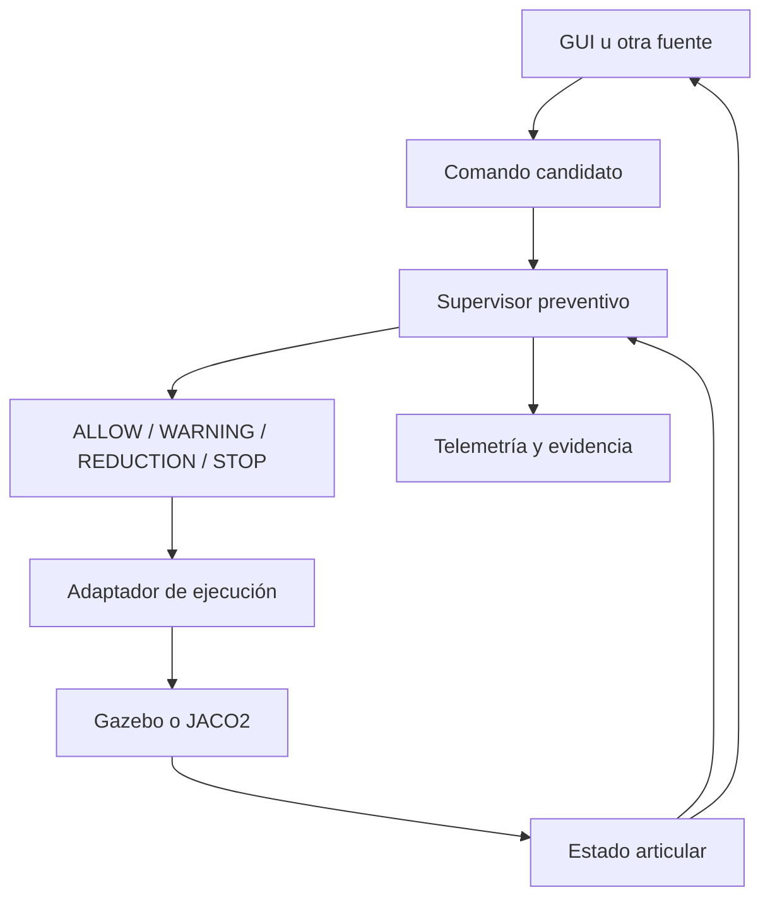

# TESIS_2_IMPLEMENTATION

**Plataforma preventiva desacoplada para comandos de movimiento en manipuladores robóticos**

Implementación experimental en ROS 2 de una capa que evalúa comandos articulares antes de transmitirlos al backend de ejecución. El sistema predice la evolución del manipulador durante un horizonte corto, estima su separación respecto del entorno y conserva la decisión más restrictiva entre `ALLOW`, `WARNING`, `REDUCTION` y `STOP`.

El Kinova JACO2 `j2n6s300` es el caso de estudio. La lógica preventiva permanece separada del robot, de la interfaz, de la fuente de obstáculos y del backend de simulación o hardware.

## Estado actual

**Estado al 18/10/2026: preparado para conexión; lectura física aún no validada.**

- Simulación y hardware físico tienen lanzamientos y adaptadores independientes.
- El brazo físico usa un adaptador nativo ROS 2–Kinova; no requiere ROS 1 ni `ros1_bridge`.
- La salida física conserva `hardware_output_enabled=false` y `armed=false`.
- El Jaco2 no está conectado actualmente; no se declara validación USB, JointState, TF, readiness, proximidad ni movimiento físico.
- A-01, A-02a, A-03 y C-01 tienen cobertura offline; A-02b permanece bloqueada por falta de contrato TF-modelo.
- La ruta cartesiana física permanece bloqueada hasta validar A-02b y resolver `TF_UNAVAILABLE`.
- La cámara RGB-D no está conectada y no existe todavía una integración `thesis_perception` validada en este workspace.
- El preflight de solo lectura está en [`tools/physical/README.md`](tools/physical/README.md).

La evidencia consolidada está en [`evidence/codex_reports/2026-10-18_preparacion_avance3_fisico.md`](evidence/codex_reports/2026-10-18_preparacion_avance3_fisico.md).

## Objetivo y alcance

La capa preventiva se interpone entre las fuentes de comandos y el subsistema de ejecución. Su objetivo es detectar anticipadamente trayectorias incompatibles con el entorno, los límites articulares, las velocidades configuradas o la disponibilidad de datos.

Esta versión incluye:

- comandos por objetivo articular y control manual continuo;
- predicción discreta de horizonte corto;
- geometría configurable mediante cápsulas;
- evaluación de separación, tendencia, tiempo a colisión, límites y velocidad;
- autorización, reducción o bloqueo de comandos;
- respuesta conservadora ante datos vencidos y fallos del controlador;
- adaptadores separados para Gazebo y el JACO2 físico;
- trazabilidad de comandos, decisiones, estados y latencias;
- interfaz gráfica diferenciada para simulación y hardware.

El puente físico cubre exclusivamente los seis ejes del brazo. El gripper, los sensores FSR, el control cartesiano y el control de esfuerzo o torque quedan fuera de este contrato.

## Flujo de información



La GUI no controla directamente el robot. Publica una intención candidata; el supervisor la evalúa y solo la salida autorizada llega al adaptador activo. El estado medido en `/joint_states` realimenta al supervisor, la interfaz y la visualización.

Para el hardware físico, el adaptador transforma la orden aprobada en llamadas a la API USB de Kinova. En simulación, otro adaptador transmite la misma salida conceptual al controlador de Gazebo.

## Modos operativos

| Modo | Backend | Movimiento físico | Uso principal |
| --- | --- | ---: | --- |
| Simulación | Gazebo | No | Desarrollo y escenarios preventivos |
| Mock físico | Backend determinista | No | Validación offline del puente |
| Físico de solo lectura | USB Kinova | No | Estado, TF y diagnóstico |
| Físico habilitado | USB Kinova | Sí, después del armado | Operación articular supervisada |

No deben ejecutarse simultáneamente dos adaptadores JACO, ROS 1 ni herramientas que abran directamente la API Kinova. `jaco_hardware_node` usa un bloqueo del dispositivo para impedir un segundo propietario del USB.

## Organización del repositorio

| Componente | Responsabilidad |
| --- | --- |
| `src/thesis_interfaces` | Mensajes compartidos y contratos de comunicación |
| `src/thesis_description` | URDF/Xacro, mallas y configuración de RViz2 |
| `src/thesis_core` | Predicción, cinemática, geometría y supervisor preventivo |
| `src/thesis_simulation` | Gazebo y adaptadores exclusivos de simulación |
| `src/thesis_hardware_bridge` | Adaptador nativo ROS 2–API USB Kinova |
| `src/thesis_hardware` | Launch físico, readiness y reglas de acceso USB |
| `src/thesis_ui` | Interfaz articular para simulación y hardware |
| `src/thesis_telemetry` | Registro de métricas y eventos |
| `src/thesis_validation` | Evaluación reproducible de escenarios |
| `tools/validation` | Ejecutores mock, físicos y de escenarios |
| `tools/physical` | Preflight físico de solo lectura y protocolo articular |
| `tools/realsense_d435i_test` | Adquisición y validación independiente de la D435i |
| `evidence/avance2` | Evidencia seleccionada de escenarios E01–E08 |
| `docs/implementation_notes` | Decisiones e instrucciones técnicas detalladas |

`build/`, `install/` y `log/` son resultados locales regenerables de `colcon` y no forman parte del código fuente versionado.

## Entorno de referencia

- Ubuntu 22.04
- ROS 2 Humble
- Gazebo Fortress, `ros_gz` y `gz_ros2_control`
- RViz2
- PyQt5
- `ros2_control` y `joint_trajectory_controller`
- Kinova JACO2 de seis ejes (`j2n6s300`)
- Intel RealSense D435i como equipo opcional; su integración con el supervisor no está validada

No se debe superponer este workspace Humble con un entorno ROS 2 Jazzy.

## Dependencia externa del JACO2

El código del proyecto está dentro de `TESIS_2_IMPLEMENTATION`. Los encabezados y la biblioteca USB de Kinova se mantienen como dependencia externa:

```text
~/Escritorio/TESIS_2_DEPENDENCIES/kinova-ros/kinova_driver
```

La ruta puede cambiarse mediante `KINOVA_ROOT`. El SDK no es necesario para ejecutar una compilación exclusivamente orientada a simulación.

## Instalación y compilación

### Obtener el repositorio

```bash
git clone https://github.com/ElLuisAlberto/TESIS_2_IMPLEMENTATION.git
cd TESIS_2_IMPLEMENTATION

source /opt/ros/humble/setup.bash
rosdep install --from-paths src --ignore-src -r -y
```

### Compilar simulación e interfaz

```bash
source /opt/ros/humble/setup.bash

colcon build --symlink-install --packages-up-to \
  thesis_simulation \
  thesis_ui \
  thesis_telemetry \
  thesis_validation
```

### Compilar el sistema físico

```bash
source /opt/ros/humble/setup.bash

export KINOVA_ROOT="$HOME/Escritorio/TESIS_2_DEPENDENCIES/kinova-ros/kinova_driver"

colcon build --symlink-install \
  --packages-up-to thesis_hardware \
  --cmake-args -DKINOVA_ROOT="$KINOVA_ROOT"
```

La compilación física incorpora la ruta de la biblioteca Kinova al ejecutable. Para recompilar, se recomienda abrir una terminal nueva y evitar cargar previamente `install/setup.bash` del mismo workspace.

Después de la primera compilación física puede prepararse el acceso USB con:

```bash
bash tools/hardware/prepare_kinova_host.sh
```

El script instala la regla `udev`, comprueba la biblioteca y verifica los símbolos requeridos. Si añade al usuario al grupo `plugdev`, es necesario cerrar sesión y volver a ingresar.

## Ejecución

Antes de cualquier lanzamiento:

```bash
cd ~/Escritorio/TESIS_2_IMPLEMENTATION
source /opt/ros/humble/setup.bash
source install/local_setup.bash
```

### Simulación completa

```bash
ros2 launch thesis_simulation thesis_system.launch.py \
  obstacle_source_mode:=topic \
  simulation_output_enabled:=true \
  use_demo_obstacle:=true \
  start_gui:=true
```

Este launch inicia Gazebo, RViz2, controladores, obstáculo sintético, monitor de proximidad, supervisor, adaptador de simulación, horizonte e interfaz.

Los argumentos más relevantes son:

| Argumento | Función |
| --- | --- |
| `simulation_output_enabled` | Permite enviar a Gazebo comandos aprobados |
| `use_demo_obstacle` | Activa el obstáculo sintético |
| `obstacle_x`, `obstacle_y`, `obstacle_z` | Posición del obstáculo, en metros |
| `obstacle_radius` | Radio del obstáculo |
| `horizon_sec` | Duración del horizonte predictivo |
| `samples` | Cantidad de muestras del horizonte |
| `margin_m` | Margen geométrico adicional |
| `start_gui` | Abre la interfaz articular |

Para utilizar una fuente perceptual que publique `/thesis/obstacle_input`, ejecutar con `use_demo_obstacle:=false`.

### Hardware físico en solo lectura

La configuración predeterminada no permite movimiento:

```bash
ros2 launch thesis_hardware jaco_physical_system.launch.py \
  mock_hardware:=false \
  hardware_output_enabled:=false \
  use_demo_obstacle:=false \
  start_gui:=false \
  start_rviz:=false \
  allow_gui_arm_control:=false \
  telemetry_output_directory:="$PWD/evidence/physical_sessions"
```

Este launch es únicamente el procedimiento posterior a una conexión física
autorizada. Antes de declarar lectura validada debe ejecutarse el preflight:

```bash
python3 tools/physical/physical_preflight.py \
  --duration-sec 10 \
  --output evidence/codex_reports/2026-10-18_preflight_fisico_solo_lectura.json
```

Si el Jaco no está conectado, solo debe ejecutarse `--static-only`.

### Movimiento físico

No se proporciona un comando de activación automática en este README. Una
primera prueba física, cuando exista autorización explícita y el preflight sea
`PASS`, debe ser articular, de un solo joint, una sola dirección, velocidad
mínima, desplazamiento pequeño, `ALLOW` previo, watchdog y STOP físico
disponible. El protocolo detallado está en `tools/physical/README.md`.

## Interfaz gráfica

En control por objetivo:

1. Esperar `/joint_states` y la conexión del backend.
2. En hardware, habilitar y confirmar el armado.
3. Esperar el estado `READY`.
4. Mantener desactivado el control manual y definir ángulos y duración.
5. Enviar el comando candidato.

En control manual:

1. Confirmar conexión, armado y estado `READY`.
2. Configurar la velocidad máxima y activar el modo manual continuo.
3. Colocar el cursor sobre la articulación y utilizar la rueda del mouse.
4. Detener la intención y comprobar la transición a `HOLD`.
5. Desactivar el modo manual antes de cerrar.

La GUI publica candidatos; nunca omite al supervisor ni controla directamente el backend.

## Interfaces principales

| Interfaz | Uso |
| --- | --- |
| `/joint_states` | Posiciones y velocidades medidas |
| `/thesis/candidate_command` | Objetivo articular candidato |
| `/thesis/supervised_command` | Objetivo autorizado |
| `/thesis/jog_intent` | Intención manual candidata |
| `/thesis/supervised_jog_command` | Intención manual autorizada o reducida |
| `/thesis/proximity_status` | Distancia y segmento limitante |
| `/thesis/trajectory_prediction` | Evaluación del horizonte candidato |
| `/thesis/execution_control` | Decisión preventiva durante la ejecución |
| `/thesis/execution_trajectory` | Estado de ejecución y resultado terminal |
| `/thesis/system_readiness` | `READY` o dependencias pendientes |
| `/thesis/hardware/diagnostics` | Estado del adaptador USB |
| `/thesis/hardware/armed` | Estado efectivo de armado |
| `/thesis/hardware/set_armed` | Servicio de armado y desarmado |

Publicar directamente al controlador omite la cadena preventiva y no constituye una prueba válida del sistema.

## Configuración preventiva

La configuración de referencia utiliza:

- horizonte de `1 s`;
- `21` muestras;
- actualización preventiva a `10 Hz`;
- margen espacial adicional de `0.02 m`;
- seis cápsulas asociadas a los segmentos principales del JACO2.

Los estados se interpretan así:

| Estado | Respuesta |
| --- | --- |
| `ALLOW` | Autoriza sin modificación preventiva |
| `WARNING` | Autoriza y registra una condición de atención |
| `REDUCTION` | Reduce la velocidad y reevalúa la trayectoria |
| `STOP` | Bloquea el comando o establece una referencia segura |

Una pérdida de datos, estado vencido, rechazo del controlador o fallo terminal produce una respuesta conservadora.

## Validación

### Pruebas automatizadas

```bash
cd ~/Escritorio/TESIS_2_IMPLEMENTATION
source /opt/ros/humble/setup.bash
source install/local_setup.bash

colcon test --packages-select \
  thesis_core \
  thesis_hardware_bridge \
  thesis_hardware \
  thesis_simulation \
  thesis_ui \
  thesis_telemetry \
  --event-handlers console_direct+

colcon test-result --verbose
```

Última validación offline del alcance físico/cartesiano:

```text
74 pruebas Python aprobadas y 1/1 suite C++ del bridge aprobada
```

### Puente físico sin hardware

```bash
bash tools/validation/run_hardware_bridge_mock.sh
```

El mock comprueba armado, supervisión, ejecución, resultado terminal, desarmado y frecuencia de estado sin abrir el dispositivo USB.

### Primera prueba física

El script histórico `tools/validation/run_kinova_physical_micro_motion.sh`
realiza ida y retorno de 2° y no corresponde al gate inicial. No usarlo para la
primera prueba. Seguir únicamente el protocolo de `tools/physical/README.md`.

## Diagnóstico rápido

```bash
ros2 topic echo --no-daemon --spin-time 2 /thesis/system_readiness
ros2 topic echo --no-daemon --spin-time 2 /thesis/hardware/diagnostics
ros2 topic echo --no-daemon --spin-time 2 /thesis/hardware/armed
ros2 topic hz --no-daemon --spin-time 2 /joint_states
```

Comprobaciones esperadas en hardware:

- un solo `jaco_hardware_node` posee el dispositivo USB;
- `connected=true` y `state_valid=true`;
- `fault=false`;
- aproximadamente 100 Hz en el lazo de control;
- aproximadamente 20 Hz en `/joint_states`;
- `armed=false` después de finalizar una prueba.

Si el SDK no informa número de serie y solo existe un JACO conectado, el adaptador selecciona de forma segura el dispositivo de índice cero y lo identifica como `KINOVA_USB_DEVICE_0`. Si hay más de un dispositivo, debe configurarse una identidad explícita.

## Seguridad operacional

- La salida física está deshabilitada por defecto.
- El movimiento exige permiso de lanzamiento y armado en tiempo de ejecución.
- El desarmado, un `STOP`, datos articulares vencidos o un watchdog activan `HOLD` o una detención conservadora.
- El adaptador conserva errores reales y finaliza limpiamente ante el apagado solicitado por ROS 2.
- Las validaciones deben ejecutarse con el área libre y la parada física accesible.
- Esta implementación es un prototipo de investigación y no reemplaza funciones de seguridad certificadas.

## Percepción RGB-D

La D435i no está conectada y no existe un paquete de percepción integrado en
este workspace. `tools/realsense_d435i_test/` contiene material independiente
de adquisición, pero no debe interpretarse como `RGBD_VALIDADA`.

El contrato futuro debe conservar:

```text
cámara -> percepción -> obstáculo válido -> obstacle_input_bridge
-> proximity_monitor -> safety_supervisor
```

Antes de conectar la percepción al supervisor faltan driver/stream real,
calibración cámara→`world`, timestamps, incertidumbre, representación de
obstáculos y pruebas offline/real con `ALLOW` y `STOP`.

## Evidencia y documentación

- `docs/codex_reports/`: diagnósticos y decisiones técnicas.
- `evidence/codex_reports/`: resultados y evidencias de pruebas.
- `evidence/avance2/`: matriz y evidencia seleccionada de simulación, cuando exista.
- `docs/implementation_notes/kinova_hardware_bridge.md`: diseño y operación del puente físico.
- `tools/validation/`: ejecutores reproducibles y validadores.
- `src/thesis_description/UPSTREAM.md`: procedencia del modelo Kinova.

## Limitaciones

- La lectura física y el movimiento físico no están validados en la sesión actual porque el Jaco no está conectado.
- A-02b permanece bloqueada por falta de un contrato explícito TF-modelo.
- No se han caracterizado todavía seguimiento, frenado y latencia bajo distintas cargas.
- La matriz preventiva completa aún no se ha repetido sobre hardware físico con obstáculos reales.
- La D435i no participa todavía en las decisiones preventivas.
- No se ha demostrado portabilidad experimental con un segundo manipulador.
- El muestreo discreto no demuestra ausencia de colisión entre muestras.
- Gripper, FSR, control cartesiano y torque permanecen fuera del alcance actual.

## Trabajo futuro

- Implementar y validar el contrato RGB-D mediante una representación desacoplada de obstáculos.
- Calibrar la transformación entre cámara y base del robot.
- Repetir progresivamente la matriz de escenarios sobre hardware físico.
- Caracterizar seguimiento, latencia y frenado con distintas configuraciones y cargas.
- Evaluar la portabilidad con otro manipulador.

## Aporte de conocimiento

El aporte central es una arquitectura desacoplada que evalúa comandos articulares mediante una predicción geométrica de corto horizonte antes de permitir su ejecución. La separación entre intención, supervisión, adaptación al backend y evidencia permite conservar el núcleo preventivo al cambiar la interfaz, el entorno de ejecución, la fuente perceptual o el manipulador.

La correlación por identificador de comando, la conservación de decisiones terminales y el monitoreo durante la ejecución proporcionan trazabilidad desde la intención inicial hasta el resultado del controlador.
